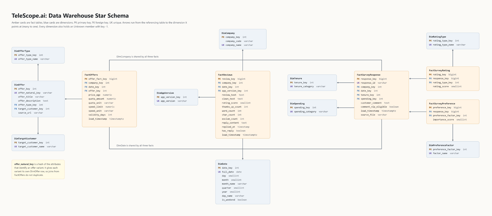

# TeleScope.ai Data Catalog

## Project Overview

TeleScope.ai integrates telecom customer reviews, customer survey responses, and telecom offers for Egyptian telecom providers. The Data Warehouse organizes the collected data into Silver and Gold layers to support analysis and reporting.

## Data Sources

| Source | Description |
|---|---|
| Google Play Store | Customer reviews and ratings for telecom applications. |
| Telecom offer data | Offers collected for telecom providers, including package details and pricing. |
| Customer surveys | Responses submitted by customers about their telecom providers, ratings, and preferences. |

The project covers WE, Vodafone, Orange, and Etisalat.

## Data Warehouse Schema

The diagram below summarizes the Gold Layer tables and their relationships.

## Silver Layer

### `silver_reviewsdata`

Contains cleaned customer reviews collected from telecom applications on Google Play Store.

| Column | Description |
|---|---|
| `review_id` | Identifier of the review from the source. |
| `content` | Original review text. |
| `score` | Customer rating. |
| `thumbs_up_count` | Number of helpful votes received by the review. |
| `review_created_version` | Application version associated with the review in the source. |
| `at` | Review submission timestamp from the source. |
| `reply_content` | Developer reply to the review, when available. |
| `replied_at` | Timestamp of the developer reply, when available. |
| `app_version` | Application version associated with the review. |
| `provider_name` | Telecom provider associated with the application. |
| `review_date` | Review date used for analysis. |
| `clean_text` | Cleaned review text prepared for analysis. |
| `word_count` | Number of words in the review. |
| `char_count` | Number of characters in the review. |
| `exclam_count` | Number of exclamation marks in the review. |
| `year` | Year of the review. |

### `silver_offers`

Contains collected telecom offers and their details.

| Column | Description |
|---|---|
| `provider_name` | Telecom provider offering the package. |
| `offer_title` | Name or title of the offer. |
| `offer_type` | Type of telecom service or package. |
| `target_customer` | Customer segment targeted by the offer. |
| `price_egp` | Offer price in Egyptian pounds. |
| `quota_amount` | Amount of included quota, when applicable. |
| `quota_unit` | Unit used to describe the quota. |
| `speed_limit` | Internet speed limit, when applicable. |
| `speed_unit` | Unit used to describe the speed. |
| `validity_days` | Offer validity period in days, when applicable. |
| `offer_category` | Category assigned to the offer. |
| `offer_description` | Description of the offer. |
| `source_url` | Link to the source of the offer. |

### `silver_survey_responses`

Contains survey submissions and customer-related information.

| Column | Description |
|---|---|
| `response_id` | Identifier of the survey response. |
| `company_name` | Telecom provider selected by the respondent. |
| `submission_date` | Date the survey was submitted. |
| `tenure_category` | Respondent's duration as a customer. |
| `spending_category` | Respondent's spending category. |
| `comment_original` | Comment submitted by the respondent. |
| `is_nlp_eligible` | Indicates whether the comment is suitable for NLP processing. |

### `silver_survey_ratings`

Contains customer ratings for different aspects of telecom services.

| Column | Description |
|---|---|
| `response_id` | Identifier of the related survey response. |
| `rating_category` | Service aspect being rated. |
| `rating_score` | Score assigned by the respondent. |

### `silver_survey_preferences`

Contains respondents' ranked preferences for telecom service factors.

| Column | Description |
|---|---|
| `response_id` | Identifier of the related survey response. |
| `preference_factor` | Factor ranked by the respondent. |
| `importance_rank` | Importance rank assigned to the factor. |

## Gold Layer

### Dimensions

| Table | Description | Columns |
|---|---|---|
| `dim_company` | Telecom providers included in the project. | `company_key`: company identifier; `company_code`: normalized company code; `company_name`: company name. |
| `dim_date` | Calendar dates used for time-based analysis. | `date_key`: date identifier; `full_date`: calendar date; `day`: day of month; `month`: month number; `month_name`: month name; `quarter`: quarter; `year`: year; `day_name`: day name; `is_weekend`: weekend indicator. |
| `dim_app_version` | Application versions associated with reviews. | `app_version_key`: version identifier; `app_version`: version label. |
| `dim_rating_type` | Survey service aspects that customers rate. | `rating_type_key`: rating category identifier; `rating_type_name`: rating category name. |
| `dim_preference_factor` | Factors customers consider important. | `preference_factor_key`: factor identifier; `factor_name`: factor name. |
| `dim_spending` | Customer spending categories. | `spending_key`: category identifier; `spending_category`: spending category. |
| `dim_tenure` | Customer tenure categories. | `tenure_key`: category identifier; `tenure_category`: tenure category. |
| `dim_offer_type` | Classifications of telecom offers. | `offer_type_key`: offer type identifier; `offer_type_name`: offer type name. |
| `dim_target_customer` | Customer segments targeted by offers. | `target_customer_key`: target segment identifier; `target_customer_name`: segment name. |
| `dim_offer` | Unique telecom offer variants. | `offer_key`: offer identifier; `offer_natural_key`: unique identifier derived from offer attributes; `offer_title`: offer title; `offer_description`: offer description; `offer_type_key`: offer type; `target_customer_key`: target customer segment; `source_url`: source link. |

### Facts

| Table | Description | Columns |
|---|---|---|
| `fact_reviews` | Customer reviews and review-related measures. | `review_key`: fact identifier; `review_id`: source review identifier; `company_key`: provider; `date_key`: review date; `app_version_key`: application version; `rating_score`: review rating; `thumbs_up_count`: helpful votes; `review_text`: original text; `clean_text`: cleaned text; `word_count`: word count; `char_count`: character count; `exclam_count`: exclamation count; `reply_content`: developer reply; `replied_at`: reply timestamp; `has_reply`: reply indicator; `load_timestamp`: load time. |
| `fact_offers` | Offer details and measurable attributes. | `offer_fact_key`: fact identifier; `company_key`: provider; `date_key`: associated date key; `offer_key`: offer identifier; `price_egp`: price; `quota_amount`: quota amount; `quota_unit`: quota unit; `speed_limit`: speed limit; `speed_unit`: speed unit; `validity_days`: validity period; `offer_category`: offer category; `offer_description`: offer description; `target_customer`: target segment; `source_url`: source link; `load_timestamp`: load time. |
| `fact_survey_response` | Individual customer survey submissions. | `response_key`: fact identifier; `response_id`: source response identifier; `company_key`: provider; `date_key`: submission date; `tenure_key`: tenure category; `spending_key`: spending category; `customer_comment`: submitted comment; `comment_nlp_eligible`: NLP eligibility indicator; `load_timestamp`: load time. |
| `fact_survey_rating` | Ratings for service aspects per survey response. | `rating_key`: fact identifier; `response_key`: related survey response; `rating_type_key`: rated service aspect; `rating_score`: rating score; `load_timestamp`: load time. |
| `fact_survey_preference` | Preference rankings per survey response. | `preference_key`: fact identifier; `response_key`: related survey response; `preference_factor_key`: ranked factor; `importance_score`: importance rank; `load_timestamp`: load time. |

## Notes

- The Gold Layer is organized around fact and dimension tables.
- The schema diagram is included as a visual overview of the Gold Layer relationships.
- `offer_category` is documented in `fact_offers`; it should also be added to the diagram to fully match the current view.
- Descriptions are intentionally kept brief to make the catalog easy for project members and reviewers to understand.
